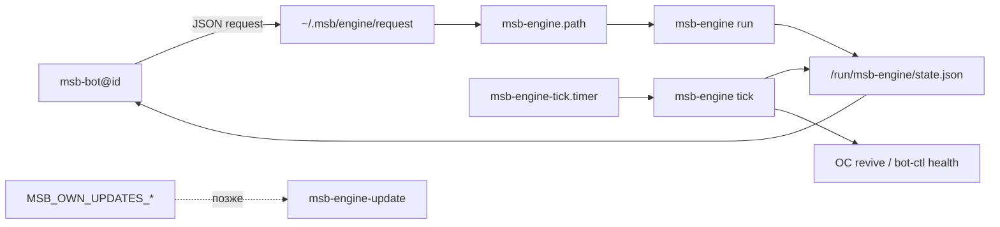

# TDR: Открытая ОС-обвязка MSB (`msb-engine`) вместо закрытого Jarvis base layer

**Статус:** Accepted (реализация v1 в ветке open-core)  
**Ветка:** `open-core`  
**Контекст:** замена `usr-local-sbin/jarvis-engine` + связанных systemd/sudoers/pulse/update на собственный стек, готовый к выкладке на серверы без хаба создателя  
**Связанные артефакты:** [`.msb/bot/OPEN-CORE.md`](../../.msb/bot/OPEN-CORE.md), `usr-local-sbin/jarvis-engine` (эталон 0.5.9), `systemd/jarvis-engine*`, `systemd/msb-base-pulse*`, `usr-local-bin/bot-ctl.sh`, `bootstrap/`

---

## Проблема

- Base layer сервера завязан на **закрытый** `jarvis-engine`: root-заявки движков, tick, nft, self-heal, pulse на SYNC создателя, signed update с их CDN.
- Open-core уже открыл бот и отрезал vendor puller/sync от затирания ядра, но **OS-обвязка** при bootstrap всё ещё ставит артефакты Jarvis — на живом боксе остаётся чужой root-helper и `NOPASSWD:ALL` (`jarvis-client` / `msb-admin`).
- Без своей обвязки нельзя честно сказать «сервер наш»: OpenClaw/engines UI, base pulse, обновления helper и firewall localhost-портов остаются чёрным ящиком.
- Цель: обвязка, которой можно **заменить** оригинал на серверах (install с нуля + миграция уже стоящих боксов) без зависимости от constructor/Jarvis update pipeline.

---

## Решение

Ввести пакет **`msb-engine`** (открытый код в репо) как единственный root-helper base layer для open-core. Имя и пути — свои (не shim навечно под `jarvis-engine`), с **временным** compatibility-режимом на миграции.

| До (создатель) | После (open-core) |
|----------------|-------------------|
| `/usr/local/sbin/jarvis-engine` | `/usr/local/sbin/msb-engine` + lib в `/usr/local/lib/msb-engine/` |
| Request: `~/.msb/engine/request` → `jarvis-engine.path` | Те же файлы заявки **или** `~/.msb/engine/request` → `msb-engine.path` (один контракт JSON) |
| State: `/run/jarvis-engine/state.json` | `/run/msb-engine/state.json` (+ symlink/compat на переход) |
| Pulse → SYNC создателя | Свой heartbeat / opt-in `MSB_OWN_*` или выкл |
| Update `.next` + их `.sig` | Свой канал `MSB_OWN_UPDATES_*` (apply — отдельный этап) |
| `jarvis-client ALL=(ALL)` | Узкий sudoers только под нужные команды |

**Ключевые решения**

| Решение | Обоснование |
|---------|-------------|
| IPC «файл заявки + path + oneshot» сохранить | Бот без root; проверенный паттерн; меньше переписывать UI движков |
| Whitelist `action` + ключей как у 0.5.9 | Предсказуемые отказы (`BAD_REQUEST`, `RATE_LIMITED`, `REPLAY`) |
| Multibot add/remove — через `bot-ctl`, не дублировать в helper | Уже сделано в open-core; helper — для OC/engines/nft/tick |
| Vendor pulse/update — не портировать | Политика open-core: свой канал позже |
| Bootstrap ставит только `msb-*`; Jarvis units mask/remove | Критерий «готово к замене на серверах» |

**Non-goals**

- Полный паритет всех edge-case install-скриптов OC в v1 (достаточно status + enable/disable + каркас add).
- Замена Claude Code / overlay Cursor-Codex.
- Реализация собственного CDN обновлений в этом TDR (только контракт и точки встраивания).

**Критерий готовности к замене на серверах (Definition of Done)**

1. Чистый `bootstrap/install.sh` на Ubuntu 24.04 ставит **только** open-core + `msb-engine` (нет активных `jarvis-engine*`, нет pulse на их SYNC).
2. Скрипт миграции `bootstrap/migrate-from-jarvis.sh`: останавливает/mask Jarvis units, ставит `msb-engine`, переносит request/state paths, сохраняет ботов и workspace.
3. Бот open-core читает/пишет новый state; engines UI не падает при отсутствии Jarvis.
4. `verify.sh` проверяет: binary, path unit, tick timer, sudoers узкий, nft опционален, нет `JARVIS_RUNTIME` enrollment blockers для наших ctl.
5. Rollback OS: только ручной из `/usr/local/lib/msb-engine/rollback/` (снимок до миграции). Откат бота на закрытый бандл снят.

---

## Поток данных

1. Бот (user `client`) атомарно пишет заявку (`v`, `id`, `action`, whitelist-поля).
2. Path unit стартует oneshot `msb-engine run` от root.
3. Helper удаляет request, валидирует, rate-limit, исполняет action, пишет `last` / `requests.<id>` без секретов.
4. Tick (15 мин): пересборка state, revive OC gateway (если включён), health `msb-bot@*`.
5. Обновления helper/бота — только свой манифест (этап 2); vendor `.next` игнорируется.

| Компонент | Роль | Где |
|-----------|------|-----|
| Helper CLI | run/setup/tick/status | `usr-local-sbin/msb-engine` |
| Actions | status, OC/Jarvis lifecycle | `/usr/local/lib/msb-engine/actions/` |
| bot-ctl | multibot add/remove/restart | `usr-local-bin/bot-ctl.sh` |
| Bootstrap + migrate | install / замена на боксе | `bootstrap/` |
| Bot client | запись request, чтение state | `.msb/bot/src/engines/` (порт) |

**Минимальный whitelist v1:** `status`, `enable-jarvis`, `disable-jarvis`, `enable-openclaw`, `disable-openclaw`, `update-openclaw` (если бинарь есть).  
**v1.1:** `add-openclaw` / `remove-openclaw` / `add-jarvis` / `remove-jarvis` / `set-model` / `import-cron` / `restore` — по мере порта с эталона 0.5.9.

---

## Что даёт

- Сервер open-core **без закрытого root-ядра** создателя: auditable helper, узкий sudoers.
- Предсказуемая миграция существующих VPS и чистая установка с одного репо.
- Сохранённый безопасный IPC для engines (бот не получает root).
- База под свой канал обновлений и свой pulse без их SYNC_KEY.
- Ops: `status` + `verify` вместо «чёрного ящика» journal Jarvis.

---

## Что остаётся на нас

- Реализация `msb-engine` (код, units, sudoers, nft-таблица опционально).
- Клиент заявок в open-core bot + экраны «Движки».
- Bootstrap/migrate/verify/rollback и прогон на тестовом боксе.
- Документация runbook для выкладки на флот.
- Уже есть и не переделываем: open-core bot, monitor/env/bots через `bot-ctl`, отключение vendor puller при `OPEN-CORE.md`.
- Позже (не блокер DoD OS-замены): полный паритет add-openclaw UX, own-updates apply CDN.

---

## Риски

| Риск / ограничение | Impact | Mitigation / follow-up |
|--------------------|--------|------------------------|
| Расхождение JSON с ожиданиями старого UI | Engines «ломаются» после миграции | Compat-writer state + фичефлаг; тесты на schema |
| Неполный порт add-openclaw в v1 | Нельзя поставить OC из меню | DoD v1 без install; install в v1.1; до тех пор CLI/runbook |
| Два helper на боксе | Конфликт path units | migrate mask’ит `jarvis-engine*`; verify падает если оба active |
| Потеря `jarvis-client ALL` | Агент/OC лишатся «полных прав» | Явный opt-in `msb-full-rights` sudoers, не по умолчанию |
| nft/localhost порты OC | Сеть/доступ агента | Порт nft.conf как опция tick/setup; документ зависимости |
| Откат OS сложнее отката бота | Долгий даунтайм | Снимок units+binary в rollback dir до migrate |

**Открытые вопросы**

1. Симлинк `/run/jarvis-engine` → `msb-engine` на весь переход или жёсткий cutover в одном релизе?
2. Нужен ли pulse вообще на флоте или только per-bot heartbeat?

---

## Следующие шаги

1. Принять TDR (статус → Accepted) и завести каталог `usr-local-lib/msb-engine/` + CLI stub `status`/`run`/`tick`.
2. Systemd: `msb-engine.path/.service`, `msb-engine-tick.timer`; правки `bootstrap/MANIFEST.txt` и `verify.sh`.
3. Порт клиента state/request в `.msb/bot/src/engines/`; экраны движков без Jarvis binary.
4. `bootstrap/migrate-from-jarvis.sh` + прогон на стенде: до/после checklist DoD.
5. Mask/remove vendor pulse & update units из чистого install; sudoers open-core.
6. v1.1: add/remove OpenClaw + nft; затем own-updates apply.

**Приёмка на сервере (чеклист)**

- [ ] `systemctl is-enabled msb-engine.path` / tick timer = enabled  
- [ ] `systemctl is-enabled jarvis-engine.path` = disabled/masked  
- [ ] `msb-engine status` → JSON без ошибок  
- [ ] Заявка `status` из бота → `OK` в state  
- [ ] `bot-ctl.sh restart default` работает  
- [ ] Нет POST на SYNC_URL создателя с base-pulse  
- [ ] Документ rollback проверен один раз на стенде  
