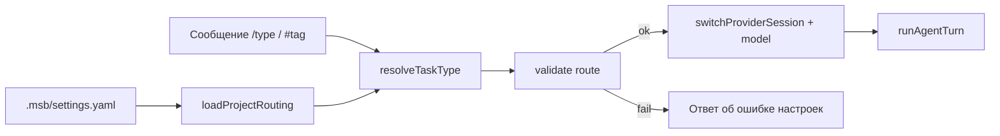

# TDR: маршрутизация задач в настройках проекта

**Статус:** In progress (v1 реализован в open-core + overlay hook)  
**Контекст:** per-bot фиксация провайдера/модели; запрос на auto-выбор по типу задачи без ошибок  
**Связанные артефакты:** [`projects/README.md`](../../.msb/bot/src/projects/README.md), [`projects/routing.mjs`](../../.msb/bot/src/projects/routing.mjs), [`agent/turn.mjs`](../../.msb/bot/src/agent/turn.mjs), [`overlay/.../apply-project-route.mjs`](../../overlay/bot/ext/apply-project-route.mjs)

---

## Проблема

- Сейчас у бота один активный провайдер/модель (`state.extAuthBypass` + `ext-providers.json`). Смена — ручная через меню.
- В проекте уже есть контекст (`.current-task.md`, memory, knowledge), но **нет** настроек «какой CLI/модель для какого класса работы».
- `.md` вроде `SOUL.md` / `CLAUDE.md` идут в prompt, а не в решение о провайдере — свободный prose как «правила маршрутизации» легко трактовать по-разному и ошибиться.
- Нужен способ: подключить несколько провайдеров → описать правила **понятно** → применять **детерминированно**, без сюрпризов mid-turn.

---

## Решение

**Выбранный подход:** настройки маршрутизации — файл проекта (не глобаль бота). Режим работы выбирается явно; карта `режим → provider/model/effort` валидируется до хода. Без LLM-классификатора в v1. Отрасль/предметная область — контекст проекта, не отдельный ключ маршрута.

| До | После |
|----|-------|
| Один провайдер на бота до ручного switch | В проекте — таблица режимов; активный режим задаёт provider/model для следующих ходов |
| Правила «в голове» или в произвольном `.md` | Один машиночитаемый файл `.msb/settings.yaml` |
| Типы «под разработку» или зоопарк отраслей | 5 универсальных режимов + aliases под любой домен |
| `.md` влияет только на текст prompt | Структурированная секция `routing` — единственный источник решения о провайдере |

### Формат настроек проекта

Путь: `<projects>/<name>/.msb/settings.yaml`  
(каталог `.msb/` внутри выбранного проекта; не путать с корневым `.msb/bot`)

```yaml
version: 1

routing:
  # false — выключить без удаления файла (мастер/агент могут вернуть true)
  enabled: true
  # Режим по умолчанию, если пользователь не закрепил другой
  default: ask
  # sticky — режим держится между сообщениями до явной смены
  # once    — режим действует на одно сообщение, затем снова default
  apply: sticky

  types:
    ask:
      provider: claude
      model: sonnet          # id из каталога провайдера; null = текущая/native
      effort: medium         # опционально; null = не трогать
    make:
      provider: codex
      model: null
      effort: high
    study:
      provider: claude
      model: opus
      effort: high
    check:
      provider: claude
      model: opus
      effort: high
    run:
      provider: cursor
      model: null
      effort: null

  # Ярлыки (домен, язык, привычка) → канонический режим
  aliases:
    вопрос: ask
    справка: ask
    сделай: make
    код: make
    дизайн: make
    монтаж: make
    графика: make
    черновик: make
    анализ: study
    аналитика: study
    данные: study
    исследование: study
    юрист: study
    бухучёт: study
    ревью: check
    проверка: check
    аудит: check
    сверка: check
    запуск: run
    выкладка: run
    операция: run
    подача: run
```

Минимальный валидный файл — только `version` + `routing.default` + полный набор `types` (см. таксономию). Отсутствие файла = поведение как сейчас (ручной per-bot выбор), routing выключен.

### Таксономия: режимы работы, не отрасли

Ось маршрутизации — **что делаем с материалом** (режим), а не **в какой отрасли** (домен).

Домен (разработка, BA, дизайн, видео, бухгалтерия, право…) задаётся проектом: имя папки, `SOUL.md` / `CLAUDE.md`, knowledge, skills. В `settings.yaml` домен не плодит отдельные типы — иначе словарь раздувается и всё равно не покрывает следующий кейс.

Закрытый набор **ровно 5 режимов**:

| Режим | Смысл (универсальный) | Примеры вне разработки |
|-------|------------------------|-------------------------|
| `ask` | Короткий ответ, объяснение, справка | «что значит эта проводка?», «какой срок исковой?» |
| `make` | Создать или изменить артефакт | код, макет, ролик, таблица, договор, презентация |
| `study` | Разобрать, исследовать, сопоставить факты | анализ данных, BA, правовое исследование, разбор метрик |
| `check` | Проверить, найти риски, принять/отклонить | ревью макета, аудит учёта, юридическая сверка, QA |
| `run` | Выполнить процедуру / операцию по шагам | выкладка, публикация ролика, сдача отчёта, регистрация |

Как чужие отрасли ложатся на режимы (не отдельные типы):

| Домен | ask | make | study | check | run |
|-------|-----|------|-------|-------|-----|
| Разработка | справка по API | фича / фикс | расследование бага | code review | деплой |
| Данные / BA | «что за KPI?» | дашборд, отчёт | анализ выборки | проверка методики | выгрузка по регламенту |
| Дизайн / графика | «какой стиль?» | макет, иллюстрация | референс-разбор | дизайн-ревью | экспорт/публикация |
| Видеомонтаж | «какой хронометраж?» | сборка ролика | разбор материала | просмотр на ошибки | выгрузка / публикация |
| Бухгалтерия | норма / термин | проводка, форма | анализ оборотов | аудит документов | сдача / отправка |
| Юриспруденция | справка по норме | черновик документа | исследование практики | проверка рисков | подача / регистрация |

Не добавлять режимы в v1. Отраслевые слова — только через `aliases` → эти пять. Новый канонический режим — отдельное решение владельца.

### Как пользователь задаёт режим (без угадывания)

Приоритет (первый выигрывает):

1. **Явный префикс в сообщении:** `#make …` / `#дизайн …` / `#анализ …` (alias) — для `apply: once` или временного override.
2. **Команда/кнопка проекта:** `/type make` или ряд кнопок «режим» на экране проекта.
3. **Закреплённый режим** в state проекта (при `apply: sticky`).
4. **`routing.default`** из файла настроек.

Нет скрытого классификатора по тексту. Нет парсинга произвольных «правил» из prose-`.md` в v1.

### Применение без ошибок

| Правило | Зачем |
|---------|--------|
| JSON Schema / жёсткий парсер YAML до первого хода | Битый файл → отказ с текстом ошибки, бот остаётся на прежнем провайдере |
| `provider` только из подключённых и известных id | Неизвестный / неавторизованный → отказ + список доступных, без silent fallback на «похожий» |
| `model`/`effort` сверяются с каталогом провайдера | Невалидная модель → отказ до `runAgentTurn` |
| Смена типа = тот же путь, что ручной switch | Переиспользовать `switchProviderSession` + `setActive` / apply-model; не второй независимый путь |
| In-flight turn не переключается | Тип применяется к **следующему** ходу; текущий fence по `sessionEpoch` сохраняется |
| Пустой/отсутствующий settings | Routing off; никакого автопереключения |
| OpenClaw | Не трогать до отдельного решения владельца |

Режим `sticky` меняет активный провайдер проекта так же явно, как кнопка в меню (пользователь видит смену в статусе агента). Режим `once` на один ход поднимает нужную parked-сессию провайдера и не переписывает «домашний» тип, если так задано в state.

**Non-goals (v1)**

- LLM/эвристика «угадай режим по тексту»
- Отдельные канонические типы по отраслям (юрист, дизайн, бухгалтерия…) — только aliases
- Свободный DSL в `.md` вместо YAML
- Отдельный провайдер на каждое сообщение без явного режима
- Глобальные (не project) routing-таблицы вместо project settings
- Автомаршрутизация OpenClaw

**Ключевые решения**

| Решение | Обоснование |
|---------|-------------|
| Файл в проекте, не в bot state | Разные репозитории/папки → разные профили работы; bot остаётся носителем auth/session |
| 5 режимов по действию, не по отрасли | Покрывает разработку, аналитику, дизайн, право и т.д. без зоопарка типов |
| Домен = контекст проекта, не ключ routing | Отрасль меняется файлами проекта; маршрут меняет только режим работы |
| Только явный выбор режима | Ошибки конфигурации видны сразу; нет «почему ушло в Codex» |
| Валидация до хода + reuse switch | Предсказуемые сессии/parking; меньше гонок |

---

## Поток данных



1. Пользователь пишет сообщение или жмёт тип.
2. Ядро читает `.msb/settings.yaml` выбранного проекта (кэш + mtime).
3. `resolveTaskType`: prefix → sticky → default; aliases нормализуются к канону.
4. `validate`: provider доступен, model/effort допустимы.
5. При смене относительно текущего — существующий switch + apply model/effort.
6. `runAgentTurn` как сейчас, уже с согласованным snapshot.

| Компонент | Роль | Где |
|-----------|------|-----|
| Project settings | Источник карты типов | `<project>/.msb/settings.yaml` |
| Resolver | Тип сообщения / sticky / default | новый модуль рядом с `projects/` |
| Validator | Отказ до хода | тот же модуль + каталоги overlay |
| Session switch | Парковка/возврат бесед | `provider-sessions.mjs`, `setup-bypass.mjs` |
| Turn | Исполнение | `agent/turn.mjs` (без второго runner) |

---

## Что даёт

- Один понятный файл на проект: «ask → Claude sonnet, make → Codex, study/check → Opus».
- Режимы не привязаны к IT; aliases закрывают язык доменов (дизайн, анализ, юрист…).
- Ошибки конфигурации ловятся до CLI, а не mid-stream.
- Сохраняется текущая модель сессий (park/resume), без параллельного «тихого» провайдера.

---

## Что остаётся на нас

- Спека файла, парсер, валидатор, resolver, точка врезки до `runAgentTurn`.
- UI: показ активного режима + кнопки/команда смены; статус при отказе валидации.
- Тесты: схема, aliases (в т.ч. отраслевые), отказ на битый YAML, switch+model, fence in-flight, project без файла.
- Уже есть и не дублируем: overlay store, `switchProviderSession`, каталоги моделей, per-bot auth/env.
- Позже (не v1): опциональный классификатор; экспорт/импорт шаблона settings; Telegram-редактор YAML.

---

## Риски

| Риск / ограничение | Impact | Mitigation / follow-up |
|--------------------|--------|------------------------|
| Частая смена режима рвёт контекст беседы между CLI | Высокий | Sticky + явный статус; не менять режим без нужды; «один режим — одна линия работы» |
| Путаница «домен vs режим» у пользователя | Средний | Подписи кнопок: «Сделать / Разобрать / Проверить…»; домен виден в имени проекта |
| Расхождение model id между каталогами | Средний | Валидация по `listModelsForProvider`; отказ с подсказкой |
| Два источника правды: меню бота vs project routing | Средний | Routing побеждает только при наличии файла; экран агента показывает эффективный маршрут |
| Желание отдельных типов «юрист», «дизайн»… | Средний | Только aliases; отрасль — в project context / skills |
| Желание «умных» .md-правил | Низкий сейчас | Phase 2; v1 сознательно детерминирован |
| OpenClaw / JARVIS_CC_ONLY | Средний | CC_ONLY игнорирует non-claude routes с явной ошибкой; OpenClaw вне scope |

**Открытые вопросы**

1. ~~Редактор settings~~ — закрыто: мастер в `/settings` → «Маршрутизация задач» + диалог с агентом (system prompt / TELEGRAM-TOOLS).
2. Нужен ли шаблон `.msb/settings.yaml` при `menu:newproject`?
3. Нужна ли вторая ось `domain:` в settings (только для подписи/фильтра skills), или домена достаточно из контекста проекта?

---

## Следующие шаги

1. Принять таксономию режимов (`ask` / `make` / `study` / `check` / `run`) и путь `.msb/settings.yaml`.
2. Зафиксировать JSON Schema файла + контрактный тест RED (нет resolver → expected fail paths).
3. Реализовать load → resolve → validate → reuse switch → turn; isolated tests GREEN.
4. Команда/кнопки режимов + отображение в agent/project screen (без отраслевых кнопок).
5. Live-приёмка на боте с ≥2 провайдерами: ask↔make, alias `#анализ`→study, битый YAML, unavailable provider.
6. Отдельным решением — Phase 2 (опциональный классификатор / richer `.md`), не смешивать с v1.
